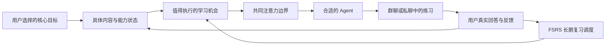

# Edison 学习 Agent 空间：研究结论与决策地图

开始：2026-10-06；更新：2026-10-07。交付范围：研究与路线，尚未实现或部署。

## 建议的主线

**以 Cumora 为群聊、私聊和独立 Agent 协作的主源码候选；以 inno-agent 研究学习状态与主动学习；以 FSRS4Anki 评估长期复习调度。** Edison 提供统一入口、目标、模型设置、资产和注意力边界。具体接入集合仍需源选型票据确认。

用户已明确：新增参考与复用项目至少 1,000 GitHub stars；底层支持通用目标，首版先做一个目标的深度闭环；站内消息为主，站外通知独立可选。雅思 8.0 暂作演示，真实目标、当前水平和期限未确认。

此次按新门槛重新筛选，早先不达标项目和复习库的推荐均已撤回。当前官方 GitHub API 快照如下，stars 随时间变化；通过门槛之后仍检查源码与实际行为。

| 项目 | 2026-10-07 stars | 推荐承担的职责 | 关键取舍 |
|---|---:|---|---|
| [Cumora](https://github.com/yetone/cumora) | 3,940 | Agent 成员、群聊、私聊、独立执行和协作协调 | MIT；前端技术栈与 Edison 一致，后台及身份/模型融合需要验证 |
| [inno-agent](https://github.com/hhyqhh/inno-agent) | 1,290 | 学习者状态、分层记忆、主动学习和延迟机会 | MIT；TypeScript/Pi 绑定较深，默认联系方式需适配 |
| [FSRS4Anki](https://github.com/open-spaced-repetition/fsrs4anki) | 4,092 | 根据真实回忆更新具体内容的长期复习间隔 | MIT；原脚本可执行，但依赖 Anki 状态，不是通用即插即用库 |
| [Anki](https://github.com/ankitects/anki) | 31,817 | 完整复习过程、评分、保留率与工作量参照 | 更完整，也更大；整体许可与运行体系不同 |

备选比较对象也均通过门槛：[OpenClaw](https://github.com/openclaw/openclaw)、[LobeHub](https://github.com/lobehub/lobehub)、[SillyTavern](https://github.com/SillyTavern/SillyTavern)、[LibreChat](https://github.com/LibreChat-AI/LibreChat)、[Open WebUI](https://github.com/open-webui/open-webui)。逐项数值、固定源码、许可证与比较见 [上游比较](../../.scratch/learning-gather/research/upstream-products.md)。

## Cumora 为什么更贴近这个产品

它的 Agent 是持续参与者，拥有独立会话，能进入群和私聊并分别判断下一步。已核查私聊创建、消息发送、发言 triage、后台主动机会与记忆范围的实际代码路径。

最有价值的部分是群聊协调：发送前发现新的同伴消息时，先让 Agent 看新状态再决定；插入消息的事务里抑制逐字重复；工作认领减少重复执行；突发唤醒会合并。它让多个 Agent 有各自的行动空间，同时降低群体碰撞。[固定协调源码与说明](https://github.com/yetone/cumora/blob/622498370cf76965a18d3c5041b040f0e57237d0/docs/COORDINATION.md)。

这已经超出“多个角色头像”的界面效果，因此值得实质复用。它仍不自带所需的学习目标与复习闭环，也不能保证所有语义重复都被阻止。

源码固定为 `622498370cf76965a18d3c5041b040f0e57237d0` / v0.18.7。原版 triage 与记忆范围测试 **63 通过、0 跳过**；私聊与消息事务仅完成源码核验，尚未启动全套服务或实测真实模型。

## 学习空间的核心结构

Agent 的自主性在于根据目标与状态选择有价值的行动。系统管理所有 Agent 共用的主动联系边界，保持用户只聚焦一两个目标。后台准备与向用户发消息是不同事件。

初始角色可以先用少量稳定职责验证，例如辅导者组织下一步练习，训练伙伴或评估者提供独立反馈。角色数、是否所有成员持续运行、群与私聊共享哪些学习状态，留给下一张人机决策票，不能在研究中替用户锁定。

## 发消息的频率应怎样决定

艾宾浩斯遗忘曲线描述记忆变化；间隔学习算法处理具体内容什么时候再练习；注意力边界处理什么时候值得联系用户。这三件事各自有依据，不能把总目标直接换算成每位 Agent 的消息频率。

主动回忆和合理间隔有研究支持，但没有证据证明某个固定提醒表对所有学习内容最优。[主动提取研究](https://pubmed.ncbi.nlm.nih.gov/16507066/)、[间隔与保留目标的研究](https://pubmed.ncbi.nlm.nih.gov/19076480/)。

建议的学习闭环是：**具体内容 → 用户尝试回忆或完成任务 → 可信反馈 → 更新状态 → 下一次机会**。没有回复只表示未完成这次练习，不能自动当成忘记；已读也不等于掌握。雅思中的词汇、表达与具体错误可进入记忆调度，完整口语、听力和写作仍需独立任务评价。

可供原型评审的低打扰起点：所有 Agent 共用每天最多一次主动邀请，有价值不足时为零；到期内容合并成短练习；未回复当天不追催；用户进入练习后自然继续。这个数字是待验证的产品假设，静默时间和额度应可设置，站外通知初始关闭。

Cumora 原本有通用 idle 主动机会，后台约 15 分钟巡检不代表每 15 分钟发消息。学习域应让主动回合围绕实际学习机会，并限制泛化闲聊唤醒。此为明确的宿主行为适配，不能暗称上游默认已经符合要求。

## FSRS4Anki 的实际复用能力

达到门槛的原版 JS 调度脚本真实更新难度、稳定性和长期间隔。在构造的 Anki 状态下，本轮执行新项与跨日复习、四档分支和 seed 契约检查；也发现同日 review 上下文的限制。

它主要修改长期复习，分钟级 learning/relearning 仍依赖 Anki 原有步骤。因此需要先确定短期练习和长期调度怎样衔接，提供完整状态适配与边界验证。不能直接把它包装成另一种库 API，就宣称学习系统完整。

实际复用应执行原脚本，保留配置、评分分支、seed/fuzz、版本、非默认分支和许可证；宿主承担内容身份、评分证据、持久化、去重与消息投递。详细来源、科学证据与契约限制见 [间隔学习研究](../../.scratch/learning-gather/research/learning-scheduling.md)。

## Grabbism 的整合路线

推荐先验证 Cumora 的**完整聊天子系统及必要后台**，将其纳入 Edison 的源码、构建、启动与同源路由。选定子系统的成员、消息、未读、私聊授权、执行、协调、失败处理、提示模板与测试都要清点；保存未调用源码或只模仿界面不算完成。

Edison 的责任是统一登录、目标与学习资产、模型设置、运行生命周期和注意力边界。上游的 Node/PostgreSQL/Redis 与宿主 Python/SQLite 是实质架构差异，需要比较资源与适配成本。现有服务器 ADR 写有 2.5 GB 内存，本轮未登录服务器重新测量；因此成本问题要验证，不能先假定可用或不可用。

inno-agent 的学习状态/主动学习子系统也按完整边界评估，避免为了它再引入一套平行 Pi 会话。邮件、移动端、公开团队看板等非首版能力列入来源和兼容清单，保持单一 Edison 用户入口。

## 决策地图与交付边界

规范地图：[学习 Agent 空间：研究与决策地图](../../.scratch/learning-gather/map.md)。四张研究票分别保存上游比较、记忆调度、宿主能力和学习项目调查；人机决策票保持开放。

接下来应确认首个学习闭环，再锁定源选型与自主性边界；完成 Cumora 最小闭包和资源可行性调查后，用便宜原型验证群/私聊体验。原生融合验收从 Edison Web 用户入口覆盖真实模型、到期练习、评分、重复事件、暂停、重启补查和限流。

当前已完成源码研究与局部执行验证，没有修改新模块的产品运行代码、启动完整候选服务或部署。研究地图使用本地 Markdown tracker；此前 GitHub 认证服务未运行，未发布远端。

详细材料：[Cumora 专项](../../.scratch/learning-gather/research/cumora.md)、[合格候选比较](../../.scratch/learning-gather/research/upstream-products.md)、[学习项目](../../.scratch/learning-gather/research/learning-products.md)、[宿主能力](../../.scratch/learning-gather/research/host-capabilities.md)、[复习调度](../../.scratch/learning-gather/research/learning-scheduling.md)。
