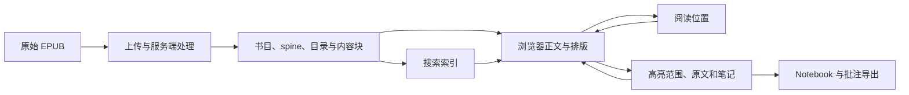

# Readwise Reader 的 EPUB 客户端逆向

2026-10-13。范围：为 Edison 的独立 EPUB Reader 提供客户端机制证据、领域模型与实施依据。本页记录原始逆向；2026-10-15 的独立实现进展见下方后续进展。

## 核心结论

Reader 最值得借鉴的不是三栏外观，而是四个互相独立的概念：**书籍内容、阅读位置、阅读进度、批注**。字体与窗口改变的是排版；书籍内容和批注所指的文字必须保持身份。书库的 Inbox/Later/Archive 只是注意力归类，也不能代替书内位置。

官方桌面包确实有分析价值。它包含可通过本地资源服务取得的 JavaScript 和带 `sourcesContent` 的 source map，能够直接研究位置序列化、分块、高亮恢复、Web 续读、导出等实现。这里提取的是发布构建提供的源映射内容，**不是完整原始仓库，也不包含已验证的服务端 EPUB 解析源码**。

对 Edison 的建议是：复用现有导航、登录和服务器，把 EPUB 阅读内核包在 Reader 自己的边界内；服务器持有原书、位置和批注。无需为了第一期 EPUB 闭环复刻 Reader 的多平台同步体系。具体方案见 [实施方案](./implementation-plan.md)。

## Reader 的实际结构

图中服务端处理仅由客户端请求、类型和消费方式推断其边界；没有声称恢复后端算法。

| 能力 | 本次查明的机制 | 对 Edison 的意义 |
|---|---|---|
| 导入 | 客户端请求上传签名，上传文件，再通知服务端建档；客户端随后取得解析状态、spine、目录与内容块 | 第一期开自己的文件导入与解析边界，不依赖 Readwise 的处理服务 |
| EPUB 内容 | 章节按 spine 顺序组织；目录保留文件路径与片段目标；跳转前会确保目标内容块已加载 | 目录和正文顺序不是同一件事；内部链接必须保持资源身份 |
| 阅读位置 | 自定义规范化 DOM 路径与 offset；保存时扣除高亮包装、控件和分页装饰影响 | 持久化逻辑位置，不能把 scrollTop 当成书籍位置 |
| 分块 | canonical 坐标消隐内容块容器，渲染时再映射回实际块；依赖各块的顶层节点数量 | 加载策略不应成为长期定位协议的一部分 |
| Web 续读 | Web 自己的 scroll hook 捕获 canonical Range；优先恢复内容位置，失败时退到比例位置 | 桌面 Web 与移动 manager 要分别研究，不能因共享代码存在就混为同一运行路径 |
| 阅读进度 | 当前停留位置与受阅读判定控制的进度分别保存；后者有阅读速度和延迟规则 | Edison 应明确区分“下次从哪继续”与“累计读到哪”，避免回读覆盖进度 |
| 高亮 | 范围恢复后对照已存文字；位置失配时尝试文字查找；失败会形成渲染失败状态 | 高亮是可重建的显示结果，锚点与摘录才是持久数据 |
| 笔记 | 整本 Document note 与某条高亮的 note 分开 | 数据模型与界面应保留两种归属关系 |
| 排版变化 | Web 观察字体、字号、行距和行宽，重新定位当前焦点元素；没有据此证明所有重排都能逐字符还原 | 用实际书籍测试契约，不能把一个 resize handler 当作稳定性验收 |
| 搜索 | 打包客户端包含 SQLite FTS5 本地索引，也有远端搜索路径；书内查找另有范围搜索实现 | 搜索范围、中文匹配和回跳定位要分别定义，不能复制一个 tokenizer 就宣称完成 |
| 导出 | Notebook 以模板调用服务端导出；下载结果为 Markdown；原文件导出是另一条路径 | 给人阅读的 Markdown 与可恢复定位数据应分开设计 |

详细位置与批注证据、原始 source 路径、行号和散列见[客户端机制调查](/Users/shiwen/Downloads/CodexProjects/ReaderAnalysis-20261013/evidence/reader-position-annotation-findings.md)。导入、内容、搜索与导出的定位信息由 [source 索引](./source-anchors.json)记录。

## 已验证与不能推出的结论

位置语法、Base62 排序编码、往返转换、非法输入校验的 **16 项独立探针全部通过**；REA Process Capture 记录了退出码 0、完整终端结果和结果文件散列。这些只验证恢复出来的纯函数，不代表浏览器 DOM、EPUB 重排或服务器保存已通过同样测试。

真实使用验证采用用户指定的本机 EPUB《阅读是安静的自我觉醒》。原件保持不动；只在副本中修改书目标题和唯一标识，以 `[REA TEST 20261013]` 识别测试资料。书籍内容资源字节保持不变。使用 Zen 走真实上传和阅读界面，并通过连接的 Readwise 只读接口核对测试批注的服务器记录。结果与清理记录见 [受控运行验证](./runtime-verification.md)。

这些边界仍然成立：

- 桌面静态快照是 **0.1.3293**；动态界面来自测试时的 Web 构建。入口资源散列不同，没有做二者的全面等价证明。
- 自定义位置协议在已研究路径中不是 EPUB CFI。它对规范化 DOM 有依赖，不意味着换书籍版本后仍能准确定位。
- 文字查找回退不等于可靠处理重复引文；本次没有证明其具备上下文评分或修复位置写回机制。
- `highlightSelfHeal` 的已定位调用属于扩展环境的 DOM 重绘，不是书籍版本迁移器。
- 已定位桌面 Web 续读调用链；移动库里的 exact-range 恢复与 feature flag 不能直接当成桌面能力证明。
- 服务端 EPUB 清洗、内容块生成、冲突合并与账户同步的内部实现仍不可见。这不妨碍按已经核实的行为契约独立实现第一期。

## REA 的实际使用与覆盖

使用 npm 发布的 **REA 6.4.0** 和同版本随包工作流，通过官方 CLI 执行安装包 inventory、plist、Mach-O、签名、JavaScript Application Graph、结果摘要、功能追踪和 Process Capture。CLI 是官方入口，未修改用户的全局 MCP 配置。

官方发布的 macOS 包 SHA-256 与 GitHub Release 的 digest 一致，签名标识为 `io.readwise.read`，签名发布者为 Readwise, Inc。包启动后从其自有 localhost 服务取得 210 个直接或递归文字引用到的脚本/映射文件，均成功取得；提取 1,297 份非 node_modules 的源映射内容，未出现同路径冲突。

REA 对其中 1,277 份相关源文件完成语法解析，解析失败为 0。全树关系图受到父结果预算约束，因此其关系覆盖是 partial；随后分别分析位置/批注的 13 个文件和书库/导入等 10 个文件，两个聚焦结构图均完整且未截断。语义图仍有动态调用和外部依赖未知，**结构图完整不等于行为完整**。

Evidence ID、完整 JSON 路径和文件 SHA-256 见 [Evidence 索引](./evidence-index.json)。原包、源映射、完整 Evidence 与重跑脚本保存在：

`/Users/shiwen/Downloads/CodexProjects/ReaderAnalysis-20261013`

大包、提取源码、测试书与含原文/资源链接的批注导出保留在本机调查目录，未放入 Edison 的产品代码或 Git 交付资料。

## 后续进展

2026-10-15 已完成限定范围的阶段 0、持久书库阶段 1、可靠续读阶段 2、批注闭环阶段 3、检索导出阶段 4 和整体验收阶段 5；完整产品闭环已通过本机正常 Web 部署入口、网页登录和服务重启验收，阶段 6 已完成生产发布与线上合成书验收，见[发布记录](./stage6-release.md)。见[阶段 5 验收](./stage5-validation.md)、[阶段 4 验收](./stage4-validation.md)、[阶段 3 验收](./stage3-validation.md)、[阶段 2 验收](./stage2-validation.md)、[阶段 1 验收](./stage1-validation.md)及[内核验证](./kernel-validation.md)。以下逆向结果仍指 2026-10-13 的 Readwise 调查，不与独立内核试验混用。

## 交付导航

- [逆向与产品边界访谈](./逆向与产品边界访谈.md)：已确认的范围、调查协议与决策历史，2026-10-16从Homework迁入。

- [独立 Reader 实施方案](./implementation-plan.md)：领域关系、最小架构、底层库候选、分期与验收。
- [受控运行验证](./runtime-verification.md)：本机书籍测试、观察限度与清理结果。
- [已接受的产品边界](../../adr/0016-independent-epub-reader.md)与[领域术语](../../../CONTEXT.md)。
- [EPUB 规范与引擎主来源调研](/Users/shiwen/Downloads/CodexProjects/ReaderAnalysis-20261013/evidence/epub-building-blocks.md)。
- [Edison 接入源码调查](/Users/shiwen/Downloads/CodexProjects/ReaderAnalysis-20261013/evidence/edison-integration-findings.md)。

## 官方入口

[REA 官方项目](https://github.com/morluto/rea)、[官方应用工作流](https://github.com/morluto/rea/blob/main/docs/javascript-application-workflows.md)、[官方 CLI](https://github.com/morluto/rea/blob/main/docs/cli.md)、[Reader 桌面发布](https://github.com/readwiseio/reader-desktop-releases/releases/tag/reader-desktop-v0.1.3293)、[Reader API](https://readwise.io/reader_api)。
