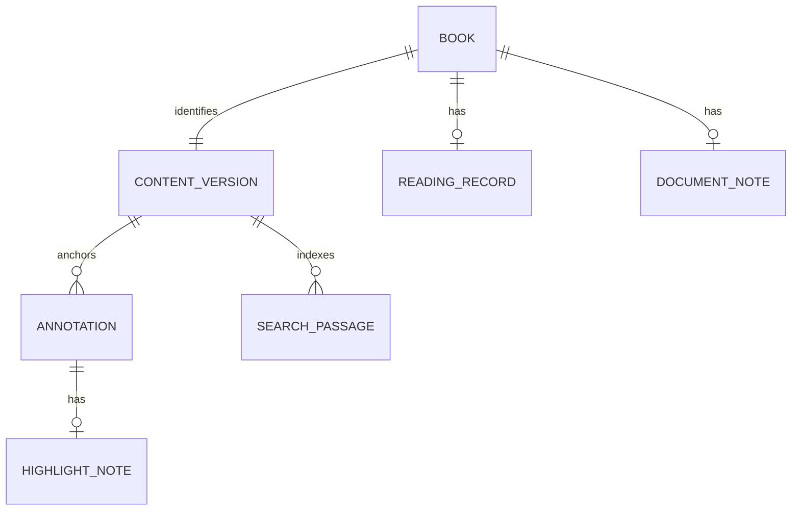
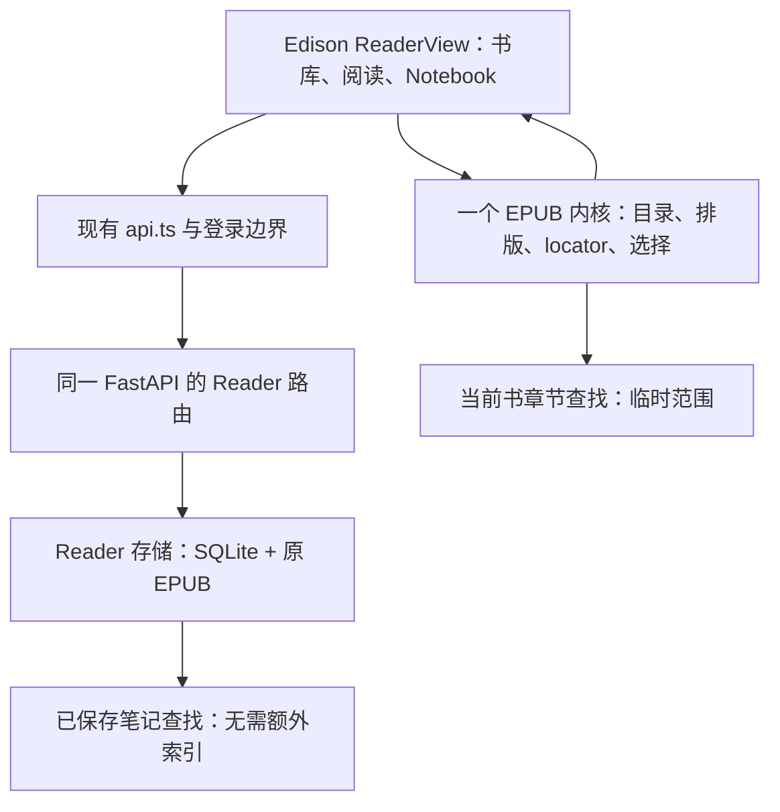

# Edison 独立 EPUB Reader 实施方案

2026-10-13 制定，2026-10-15 更新。**这是 Edison 的独立实现方案，不是 Readwise 内部实现的复述。** 阶段 0–5 已通过本地验收；阶段 6 已完成生产发布及正常 Zen 登录、保存、检索与下载验收。已接受的范围见 ADR 0016。

## 接手进展（2026-10-15）

阶段 0 在“可重排 EPUB、单章节文字选区”的范围内通过；固定版式和图片/SVG 独立章节明确拒绝。阶段 1 已实现独立入口、服务器原书与书目、内容去重、Inbox/Later/Archive、重开与原书下载，并通过真实 FastAPI + 生产 GUI 的三浏览器端到端验证。详见[阶段 1 验收](./stage1-validation.md)与[内核验证](./kernel-validation.md)。阶段 2 已持久保存停读位置、最远到达位置和每本书的字号/目录偏好，支持精确恢复、失败重试及并发冲突处理；三浏览器 36 个端到端场景全部通过，见[阶段 2 验收](./stage2-validation.md)。阶段 3 已实现文字高亮、整本/高亮笔记、Notebook 回跳和失配状态；完整 Reader 三浏览器 66 项全部通过，见[阶段 3 验收](./stage3-validation.md)。阶段 4 已实现当前书正文检索、全库已保存摘录/笔记检索和 Markdown/JSON 导出；完整 Reader 三浏览器 84 项全部通过，见[阶段 4 验收](./stage4-validation.md)。阶段 5 已通过本机 Web 部署形态下的 6 条完整链路和 84 项 Reader 回归，见[整体验收](./stage5-validation.md)。阶段 6 已发布至自有服务器并完成线上合成书验收，见[生产发布](./stage6-release.md)。

## 产品形态

Edison 导航增加 Reader。进入后先见书库；打开一本书后，主区域承担阅读，左侧目录和右侧 Notebook 可收起。整体视觉沿用 Edison，阅读区避免出现技术配置。导入、保存失败、位置失配等情况直接说明结果与可恢复动作。

第一期只接收新导入 EPUB，完成书库归类、阅读续读、高亮笔记、检索和导出。书籍与阅读记录由自有服务器持有。当前电脑是验收环境，不意味着数据放进浏览器缓存。PDF、Readwise 旧库迁移、离线与跨设备验收不进入本期。

## 领域模型

这张图表达领域关系，不要求六张独立表。第一期原书不可变，一本书只绑定一个内容版本，版本身份可直接放在书籍记录里；没有必要提前开发版本迁移系统。

| 概念 | 契约 |
|---|---|
| 书籍与内容版本 | 服务端身份独立于文件名。保留原 EPUB，并绑定原文件散列和导入规则版本。改标题只改展示元数据；不同内容不能因同名而合并 |
| Inbox / Later / Archive | 管理阅读意图；归档仍保留原书、位置和批注 |
| 停读位置 | 下一次打开的起点；引用内容版本、章节资源及精确 locator；比例仅作显示，不作定位降级 |
| 阅读进度 | 与停读位置分离。当前采用“最远到达位置/进度”，含主动跳转，回读不倒退；不代表读完或理解 |
| 高亮 | 稳定 ID、内容版本、章节、范围 locator、摘录与必要上下文；颜色是显示属性。渲染高亮不改写持久原文 |
| 笔记 | 整本笔记与高亮笔记有明确归属，不用一条无锚点文本包揽所有笔记 |
| 搜索命中 | 指向内容版本和可回跳片段；命中文字不能映射到原文时，不能假装定位成功 |
| 导出 | 原 EPUB 原样下载；Markdown 表达摘录与理解；JSON 保留版本与定位器。Markdown 本身不是完整恢复备份 |

已实现对相同文件散列返回已有书籍、保留归类；同名不同字节独立导入。未来阅读记录沿用已有书籍身份，第一期不自动迁移批注。这是 Edison 自己的契约，不是已验证的 Readwise 去重规则。

## 最小架构

宿主已有足够的导航、同源 HTTP、鉴权、下载与数据目录惯例。建议前端独立 ReaderView，复用 `api.ts`；后端以一个 Reader 路由模块挂载到同一 FastAPI，使用数据根下的 `reader` 目录。Reader 自己拥有书籍、位置与批注，不复用 YouTube 的视频身份或课程文档身份。

刷新恢复需要显式支持 Reader 的 module/book URL，不能只增加一个按钮。原书和章节资源沿宿主受保护的资源路径提供；实现时核对线上 Caddy 的鉴权与上传边界。书籍渲染内容不执行书内脚本，不可获得宿主登录上下文。详细接入依据见[宿主调查](/Users/shiwen/Downloads/CodexProjects/ReaderAnalysis-20261013/evidence/edison-integration-findings.md)。

最初只需要窄的内核接入契约：打开书、取得目录、跳到 locator、取得当前 locator、调整排版、取得选区、绘制/移除批注、执行书内查找。不开发通用插件平台。

## 引擎候选与选择门槛

已在限定支持范围内选用 **Foliate-js 固定 commit**。它提供 EPUB、CFI、排版、覆盖绘制与搜索的较小组合，MIT 许可；但作者明确 API 不稳定、没有正式 release，因此固定版本，并对本机浏览器做契约验证。固定点为 `78914aef4466eb960965702401634c2cb348e9b1`。[固定 README](https://github.com/johnfactotum/foliate-js/blob/78914aef4466eb960965702401634c2cb348e9b1/README.md)

备选为 **Readium Web**。维护与标准 Locator/Decoration 模型更系统，但接入需要 WebPub manifest 和 positions 等准备。`@readium/navigator` 调研版本为 2.12.1，BSD-3-Clause。[Publication 接入要求](https://github.com/readium/ts-toolkit/blob/bef9dfc579732bf922badebbe24ada5d8e32af19/navigator/docs/HandlingPublications.md)

epub.js 作为兼容参照；npm 发布较旧，但源码仍有后续提交，不能简单判为弃养。完整对比、许可证与主来源见[引擎调研](/Users/shiwen/Downloads/CodexProjects/ReaderAnalysis-20261013/evidence/epub-building-blocks.md)。

选择门槛由实际契约决定：用户的中文 EPUB、EPUB 2 NCX 与 EPUB 3 nav、图片、脚注、字号/宽度变化、刷新和范围回跳，必须在 Zen/Firefox 上验证。API 不稳定可以通过固定版本控制；locator 不稳定则不能进入正式接入。

## 定位器建议

使用候选引擎支持的 CFI/Locator 作为精确主锚，并同时保存章节资源、原文摘录和上下文。当前在同一内容版本恢复精确范围并校验摘录，失败时明确显示失配、保留记录；尚未实现按章节和上下文查候选。未来若增加候选恢复，多处命中必须明确标记歧义。批注不得降级为一个看似准确的百分比位置。

CFI、DOM Range 与 Web Annotation 的文字 offset 单位不同，尤其涉及 UTF-16、Unicode code points、emoji 和组合字符。规范化文本必须有明确口径和原文映射。建议批注用覆盖层/装饰呈现，减少临时 DOM 包裹对位置计算的影响。这些是独立设计，不能说成 Readwise 已采用的协议。

## 实施顺序与每阶段出口

| 阶段 | 交付 | 必须通过的出口 |
|---|---|---|
| 0：内核验证 | 一个隔离试验页、固定依赖版本、定位器样例 | 实际中文书与标准测试书可读；目录、图片、脚注正确；改字号/宽度后同一范围可恢复。失败则在这里换内核 |
| 1：持久书库 | 新导入 EPUB、服务器原文件与书目、Inbox/Later/Archive、Edison 导航 | 刷新和重新打开仍存在；重复导入契约明确；原文件下载散列一致；未知/失败导入有明确反馈 |
| 2：可靠续读 | 目录导航、排版偏好、停读位置与阅读进度 | 改字号、展开侧栏、刷新后回到同一段；两个标签页不会用旧状态静默覆盖新记录；保存失败可见 |
| 3：批注闭环 | 文字高亮、整本/高亮笔记、Notebook 回跳 | 重排/刷新后高亮对应同一原文，跨标签、中文混排和重叠选区可处理；不能恢复时显示待修复状态 |
| 4：检索与导出 | 书目查找、书内全文、批注/笔记检索；原书、Markdown 和定位 JSON 导出 | 中文词语命中且回跳正确段；摘录/笔记数量与服务器一致；JSON 定位数据可重新解析并核对原文 |
| 5：整体验收 | 本机正常 Web 部署入口的完整闭环（已通过）；生产复核见阶段 6 | 新导入→归类→阅读→续读→批注→检索→导出全流程；用户原有课程与 YouTube 流程通过相关回归 |
| 6：生产发布 | 隔离候选、原子发布、回退资料、线上合成书验收（已完成） | 正常登录、保存、刷新、检索与实际下载，原有数据及鉴权边界保持 |

第一期已实现书名/作者查找、当前书正文查找、全库已保存高亮与笔记检索。正文和笔记采用区分大小写的原文子串匹配；正文最多显示 200 个位置，笔记结果分页。全库所有书正文联合排名留作后续扩展。

“只支持 EPUB”不等于默认支持每一种 EPUB。内核试验应覆盖重排、固定版式、RTL/竖排、内嵌字体和跨章节选择；不能支持的类型在导入或选择时给出明确行为。第一期可把单次选择限制在一个 spine 资源内，不能悄悄截掉另一端。

## 验收的判断标准

每次都从正常产品入口开始，使用真实服务器持久化。把同一原文范围的身份、原书散列、批注数量和导出结果作为判断依据。只看到一本书、一次着色或一个下载按钮不构成完成。

Reader 已上线；Caddy 的原登录边界保持不变。当前验收覆盖本机生产构建与隔离真实服务器；书内检索与导出已通过阶段 4 验收；阶段 5 另外覆盖本机 HTTPS + Caddy + 正常服务器入口、登录失效和服务进程重启。阶段 6 已完成线上发布后验收；超大书/大量批注性能仍未覆盖。
